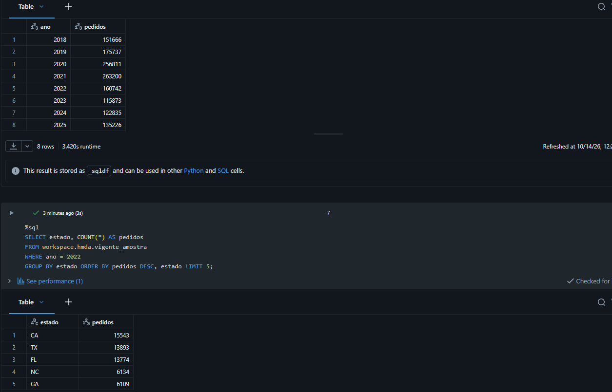
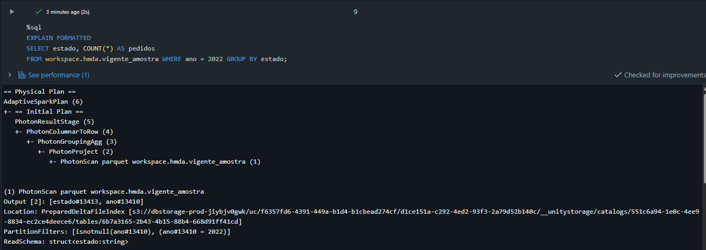
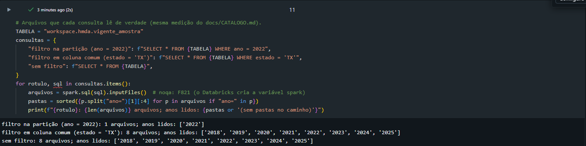

# Databricks Free Edition: o mesmo lakehouse no Unity Catalog

O exercício de `docs/CATALOGO.md`, agora no Databricks: uma amostra de 1% da silver vira uma tabela Delta do **Unity Catalog**, particionada por ano. O notebook confere que os números são idênticos aos do Spark local e mostra, com `EXPLAIN`, que o filtro por ano lê só a pasta do ano.

**Por que uma amostra:** o Free Edition tem cota diária de processamento, armazenamento não documentado e acesso à internet só para domínios aprovados (não baixa do FFIEC). Com 1% de cada ano (1.382.090 linhas, 54,7 MB) a estrutura é a mesma e cabe na cota.

> **Estado:** executado em 14/10/2026 no Databricks Free Edition (serverless, Unity Catalog `workspace.hmda`). **Todos os números bateram com o Spark local** e o plano mostrou a mesma poda de partições. Resultado abaixo.

## Resultado no Databricks (14/10/2026)

| Conferência | Spark local (gabarito) | Databricks |
|---|---|---|
| Pedidos por ano, 2018–2025 | 151.666 · 175.737 · 256.811 · 263.200 · 160.742 · 115.873 · 122.835 · 135.226 | idênticos |
| Top 5 estados em 2022 | CA 15.543 · TX 13.893 · FL 13.774 · NC 6.134 · GA 6.109 | idênticos |
| Plano com `WHERE ano = 2022` | `PartitionFilters: [isnotnull(ano), (ano = 2022)]`, `ReadSchema: struct<estado:string>` | igual (no motor Photon) |
| Plano com `WHERE estado = 'TX'` | sem filtro de partição | sem filtro de partição; o filtro vira `DictionaryFilters` e `RequiredDataFilters`, aplicados dentro dos arquivos |
| Arquivos lidos com `ano = 2022` | 14 de 109, só a pasta `ano=2022` | 1 de 8, só `ano=2022` |

A tabela do Databricks tem **1 arquivo por ano** porque a amostra é pequena (54,7 MB); na silver local são 109 arquivos. A proporção é a mesma: o filtro na partição lê só o ano pedido, e o filtro em coluna comum lê todos.







## Passo a passo (uma vez, ~20 minutos)

1. **Gerar a amostra** (já feita em 14/10/2026; refazer só se a silver mudar):
   ```bash
   MSYS_NO_PATHCONV=1 docker compose run --rm -T spark python -m hmda.amostra
   ```
   Sai em `C:\dados\hmda\databricks\amostra_silver.parquet`.
2. **Criar a conta:** https://www.databricks.com/learn/free-edition → *Sign up*. Use o seu e-mail. Não pede cartão.
3. **Criar o esquema e o volume:** abra **SQL Editor** e rode as duas primeiras linhas do notebook (`CREATE SCHEMA ...` e `CREATE VOLUME ...`). Se o catálogo `workspace` não existir na sua conta, veja o nome em **Catalog** (menu da esquerda) e troque `workspace` no notebook inteiro.
4. **Subir o arquivo:** **Catalog** → `workspace` → `hmda` → **Volumes** → `arquivos` → **Upload to this volume** → escolha `amostra_silver.parquet`.
5. **Importar o notebook:** **Workspace** → seu usuário → **Import** → **File** → `databricks/catalogo_hmda.py` deste repositório.
6. **Rodar:** abra o notebook, conecte em **Serverless** e clique em **Run all**.
7. **Conferir** com a tabela abaixo e tirar prints: o resultado de "pedidos por ano", o `EXPLAIN` com `PartitionFilters` e a aba **Lineage** da tabela no Catalog Explorer. Os prints vão para `docs/img/` e para a página.

## Números esperados (Spark local, mesmo arquivo)

Mesma amostra = mesmos números. Qualquer diferença é sinal de leitura errada.

| Ano | Pedidos na amostra |
|---|---|
| 2018 | 151.666 |
| 2019 | 175.737 |
| 2020 | 256.811 |
| 2021 | 263.200 |
| 2022 | 160.742 |
| 2023 | 115.873 |
| 2024 | 122.835 |
| 2025 | 135.226 |

Cinco estados com mais pedidos em 2022: CA 15.543 · TX 13.893 · FL 13.774 · NC 6.134 · GA 6.109. Total do Texas (todos os anos): 111.312. A amostra tem as mesmas 63 colunas da silver.

## O que cada lado mostra

| | Spark local (Docker) | Databricks Free |
|---|---|---|
| Catálogo | Metastore Hive com Derby embutido (`/lake/metastore`) | Unity Catalog (`workspace.hmda`) |
| Tabelas | Externas: o catálogo aponta para pastas Delta que já existem | Gerenciada: o Databricks guarda os arquivos |
| Dados | Silver inteira, 4,8 GB, 2018–2025 | Amostra de 1% |
| Extra | Nada além do Delta | Linhagem, permissões e histórico na interface |

## Limites do Free Edition (conferidos em 06/10/2026)

Só computação serverless; cota diária (se estourar, desliga até o dia seguinte); um SQL warehouse 2X-Small; internet só para domínios aprovados; uso comercial proibido.
